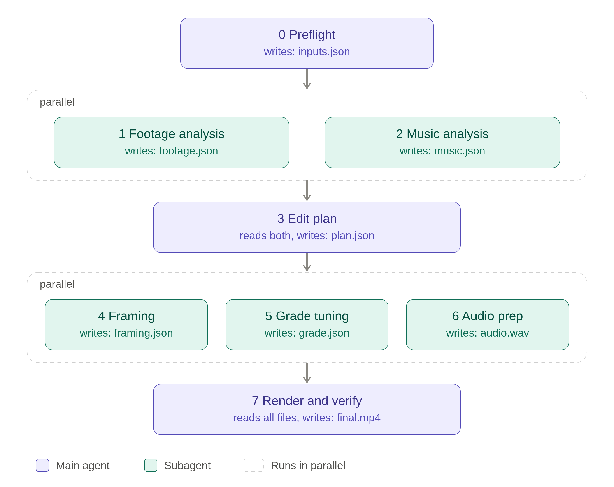

# CookingFlow



CookingFlow is a documented, agent-assisted workflow and set of Python helpers for turning user-selected cooking footage and music into a reviewed Instagram Reel. It coordinates footage and music analysis, edit planning, framing and color-grade decisions, rendering, audio mixing, and technical/editorial verification.

## Workflow

The workflow is defined in [`workflow/`](workflow/) and runs in these stages:

1. **Preflight:** confirm the user's chosen clips and music, and check that the sources are accessible.
2. **Analyze in parallel:** identify useful cooking actions in the footage and inspect music timing, energy, and beat evidence.
3. **Plan the edit:** build a shot timeline from those analyses.
4. **Prepare in parallel:** decide framing/crops and tune the grade for the selected footage.
5. **Render and verify:** render the vertical edit, mix its audio, inspect output evidence, and check Reels requirements.

The workflow's standard deliverable is a 9:16 Reel under 30 seconds, with a final `final.mp4` and `verification.md`. It uses saved intermediate state in `workdir/` so validated work can be resumed when inputs and tool versions still match.

## Tools

The reusable helpers in [`tools/`](tools/) support:

- Inspectable frame and cut evidence, including contact sheets and crop views.
- Music analysis with cached audio data and beat/high-point evidence.
- LUT grade previews and saved-edit validation/rendering.
- Render manifests, dependency-aware caching, technical checks, and optional audio-stem verification.

Media probing, decoding, transformation, and export are performed through the repository's installed [FFmpeg skill](.claude/skills/ffmpeg-skill/SKILL.md). The helpers do not overwrite source media; generated state and renders belong in the git-ignored `workdir/` directory. See [`tools/README.md`](tools/README.md) for helper commands, contracts, and limitations.

## Running the workflow

For an edit, begin with [`workflow/00-index.md`](workflow/00-index.md) and follow the relevant step instructions and handoffs. Provide the media files under `Clips/` and `Sounds/`, then explicitly select which clips and music to use. The workflow does not choose source footage or music on the user's behalf.

Python helper usage and verification instructions are documented in [`tools/README.md`](tools/README.md). The helper unit tests can be run with:

```bash
python3 -m unittest discover -s tools -p 'test_*.py' -v
```
